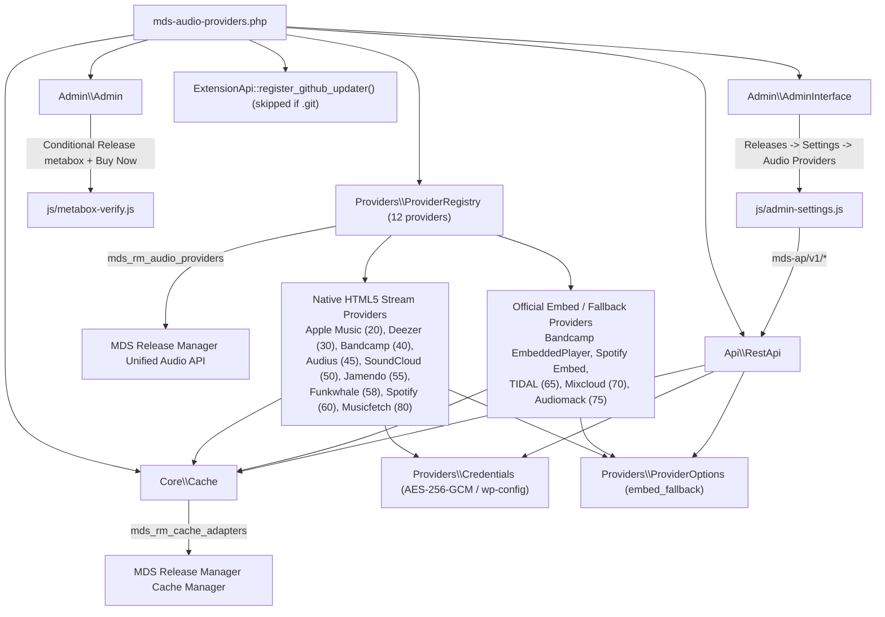

# Technical Blueprint — MDS Audio Providers

## Architecture Overview

- **Plugin Name:** `MDS Audio Providers`
- **Plugin Slug / Text Domain:** `mds-audio-providers`
- **Version:** `2.1.1`
- **PHP Root Namespace:** `MDS\AudioProviders\` (Composer PSR-4 autoloaded from `src/` via `vendor/autoload.php`)
- **Prefixes:** `MDS_AP_` (constants; legacy `MDS_BC_VERSION`, `MDS_BC_PATH`, `MDS_BC_URL` aliases preserved), `mds_ap_` (options, transients, nonces, meta), `mds-ap-` (admin script/style handles; `mds-bc-metabox` and `mds_bc_verify_url` retained for metabox compatibility)
- **Compatibility:** WordPress `7.0+` (`Tested up to: 7.x`), PHP `8.0+`
- **Required Dependency:** **MDS Release Manager** (`Requires Plugins: mds-release-manager`), specifically its Unified Audio API (`MDS\ReleaseManager\Core\Audio\AudioProviderInterface` and `mds_rm_audio_providers`). When MDS Release Manager is inactive, a standalone **Settings → Audio Providers** fallback screen remains accessible with a dependency warning.
- **GitHub Auto-Updater:** Registers `bwalton64/mds-audio-providers` via `MDS\ReleaseManager\Api\ExtensionApi::register_github_updater()` on `mds_rm_loaded` (guarded by `! is_dir( MDS_AP_PATH . '.git' )` so WordPress auto-updates never overwrite a local Git development checkout; optional `MDS_AP_GITHUB_TOKEN` constant).
- **Build System:** Composer (`composer.json` + `phpcs.xml.dist` with WPCS 3.x and PHPCompatibilityWP). Admin JavaScript (`js/admin-settings.js`, `js/metabox-verify.js`) and CSS (`css/admin.css`) are authored directly without an npm/webpack build step.

## Architecture Diagram



## Directory Structure

```text
mds-audio-providers/
├── .agents/
│   ├── research/streaming-providers-feasibility.md  # Ecosystem feasibility study & phased roadmap
│   ├── rules/project-config.md                      # Plugin variables, prefixes, namespace, LocalWP paths
│   └── technical-blueprint.md                       # This architecture reference
├── .github/
│   └── workflows/release.yml                        # Tag-driven ZIP build, SHA-256 checksum, GitHub Release
├── css/
│   └── admin.css                                    # Admin settings styles
├── js/
│   ├── admin-settings.js                            # WP 7.x React Admin UI (12 providers, toggles, creds, cache)
│   └── metabox-verify.js                            # Bandcamp verifier, embed-snippet parser, Buy Now bridge
├── languages/
│   └── mds-audio-providers.pot                      # Translation catalog template
├── src/
│   ├── Admin/
│   │   ├── Admin.php                                # Conditional Release metabox, Buy Now button, AJAX verifier
│   │   └── AdminInterface.php                       # Releases -> Settings -> Audio Providers tab & standalone fallback
│   ├── Api/
│   │   └── RestApi.php                              # mds-ap/v1 REST endpoints (/settings, /test-connection, /clear-cache)
│   ├── Core/
│   │   ├── Cache.php                                # Selective transient cache, key index, Release Manager cache adapter
│   │   ├── Dependencies.php                         # Checks for MDS Release Manager and AudioProviderInterface
│   │   └── Logging.php                              # WP_DEBUG / WP_DEBUG_LOG structured error_log() wrapper
│   └── Providers/
│       ├── AppleMusicProvider.php                   # Priority 20 — Zero-auth iTunes UPC lookup (30s .m4a, 12h TTL)
│       ├── AudiomackProvider.php                    # Priority 75 — Zero-auth Audiomack official iframe embed (12h TTL)
│       ├── AudiusProvider.php                       # Priority 45 — Zero-auth Audius Open Audio 320kbps stream (1h TTL)
│       ├── BandcampProvider.php                     # Priority 40 — JIT stream + optional EmbeddedPlayer fallback (30m TTL)
│       ├── Credentials.php                          # wp-config.php overrides + AES-256-GCM / CBC+HMAC encrypted options
│       ├── DeezerProvider.php                       # Priority 30 — Zero-auth Deezer UPC lookup (30s .mp3, 12h TTL)
│       ├── FunkwhaleProvider.php                    # Priority 58 — Self-hosted / Fediverse pod REST streams (1h TTL)
│       ├── JamendoProvider.php                      # Priority 55 — Free client_id API v3.0 direct .mp3 streams (12h TTL)
│       ├── MixcloudProvider.php                     # Priority 70 — Zero-auth oEmbed + official iframe widget (12h TTL)
│       ├── MusicfetchProvider.php                   # Priority 80 — Optional paid BYO x-token UPC resolver (12h TTL)
│       ├── ProviderOptions.php                      # Per-provider boolean toggles (embed_fallback for Bandcamp/Spotify)
│       ├── ProviderRegistry.php                     # Registers all 12 AudioProviderInterface implementations
│       ├── SoundCloudProvider.php                   # Priority 50 — OAuth 2.1 /resolve, /preview, /streams (15m TTL)
│       ├── SpotifyProvider.php                      # Priority 60 — OAuth 2.0 UPC preview_url + optional embed fallback (12h TTL)
│       └── TidalProvider.php                        # Priority 65 — OAuth 2.0 v2 UPC lookup or TIDAL URL -> embed.tidal.com (12h TTL)
├── tests/
│   └── providers.php                                # Standalone PHP unit tests covering all 12 providers
├── composer.json                                    # PSR-4 autoloading ("MDS\\AudioProviders\\": "src/") + WPCS/PHPCompatibilityWP
├── mds-audio-providers.php                          # Plugin header, constants, autoloader, hook bootstrap, .git updater guard
├── phpcs.xml.dist                                   # WPCS + PHPCompatibilityWP ruleset (WP 7.0+, PHP 8.0+)
├── README.md                                        # Developer & repository documentation
├── readme.txt                                       # WordPress.org plugin directory metadata & changelog
├── uninstall.php                                    # Single-site and multisite option/transient cleanup
├── USER-MANUAL.md                                   # End-user and site-admin manual
├── wpml-config.xml                                  # WPML copy rules for Release audio provider custom fields
└── changelog.md                                     # Append-only Keep a Changelog history
```

## Data Storage & Configuration Contracts

### WordPress Options

| Option Key | Owner | Purpose |
| :--- | :--- | :--- |
| `mds_ap_credentials` | `MDS Audio Providers` | Encrypted provider credentials (`soundcloud`, `spotify`, `tidal`, `jamendo`, `funkwhale`, `musicfetch`; non-autoloaded). |
| `mds_ap_provider_options` | `MDS Audio Providers` | Per-provider boolean feature toggles (`bandcamp.embed_fallback`, `spotify.embed_fallback`; non-autoloaded). |
| `mds_ap_cached_keys` | `MDS Audio Providers` | Bounded (max 250) index of active `mds_ap_*` transients for diagnostics and Redis/Memcached-safe clearing. |
| `mds_rm_audio_provider_priority` | `MDS Release Manager` | Ordered array of provider slugs updated via `POST /mds-ap/v1/settings`. |
| `mds_rm_audio_disabled_providers` | `MDS Release Manager` | Disabled provider slugs updated via `POST /mds-ap/v1/settings` and read by `Admin::is_provider_enabled()`. |

### `wp-config.php` Constants (Optional Overrides)

| Constant(s) | Provider / Feature |
| :--- | :--- |
| `MDS_AP_SOUNDCLOUD_CLIENT_ID`, `MDS_AP_SOUNDCLOUD_CLIENT_SECRET` | SoundCloud OAuth 2.1 |
| `MDS_AP_SPOTIFY_CLIENT_ID`, `MDS_AP_SPOTIFY_CLIENT_SECRET` | Spotify OAuth 2.0 |
| `MDS_AP_TIDAL_CLIENT_ID`, `MDS_AP_TIDAL_CLIENT_SECRET` | TIDAL Open API v2 OAuth 2.0 |
| `MDS_AP_JAMENDO_CLIENT_ID` | Jamendo API v3.0 |
| `MDS_AP_FUNKWHALE_POD_URL`, `MDS_AP_FUNKWHALE_TOKEN` | Funkwhale Pod URL & optional Bearer token |
| `MDS_AP_MUSICFETCH_API_KEY` | Musicfetch `x-token` (BYO paid key) |
| `MDS_AP_GITHUB_TOKEN` | Optional GitHub token for Release Manager's GitHub updater |

### Release Post Meta (`post_type = release`)

| Meta Key | Core Fallback Read | Provider | WPML (`wpml-config.xml`) |
| :--- | :--- | :--- | :--- |
| `upc_ean` | Owned by Core | Apple Music, Deezer, Spotify, TIDAL, Musicfetch | Managed by Core |
| `bandcamp_album_id`, `bandcamp_album_url`, `mds_bandcamp_integration` | — | Bandcamp | `copy` |
| `mds_ap_audius_url` | `audius_url` | Audius | `copy` |
| `mds_ap_soundcloud_url` | `soundcloud_url` | SoundCloud | `copy` |
| `mds_ap_jamendo_url` | `jamendo_url` | Jamendo | `copy` |
| `mds_ap_funkwhale_url` | `funkwhale_url` | Funkwhale | `copy` |
| `mds_ap_tidal_url` | `tidal_url` | TIDAL | `copy` |
| `mds_ap_mixcloud_url` | `mixcloud_url` | Mixcloud | `copy` |
| `mds_ap_audiomack_url` | `audiomack_url` | Audiomack | `copy` |
| `mds_ap_spotify_url` | `spotify_url` | Spotify (embed fallback) | Managed by Core |

### Transients & Uninstall Cleanup

- **Provider manifests:** `mds_ap_<provider>_<md5(target)>` (12h UPC/embed providers, 1h Audius/Funkwhale, 30m Bandcamp, 15m SoundCloud, 3m error backoff; Musicfetch honors HTTP `429 Retry-After` up to 1h).
- **OAuth tokens:** `mds_ap_soundcloud_token`, `mds_ap_spotify_token`, `mds_ap_tidal_token`.
- **Uninstall (`uninstall.php`):** Deletes `mds_ap_credentials`, `mds_ap_provider_options`, `mds_ap_cached_keys`, all OAuth token transients, and all `_transient_mds_ap_*` / `_transient_timeout_mds_ap_*` rows across single-site and Multisite installs while preserving Release post metadata.

## Hook, REST, AJAX & Runtime Contracts

- **Release Manager Hooks:** `mds_rm_audio_providers`, `mds_rm_cache_adapters`, `mds_rm_purge_cache` (emitted), `mds_rm_loaded`, `mds_rm_site_settings_tabs`, `mds_rm_register_custom_meta_boxes`, `mds_rm_save_release_meta`, `mds_rm_after_buy_now_field`, `mds_rm_default_media_formats`.
- **REST API (`mds-ap/v1`, `manage_options`):**
  - `GET /mds-ap/v1/settings` — Returns `{ providers, credentials, provider_options, cache }`.
  - `POST /mds-ap/v1/settings` — Persists `priority`, `disabled`, `credentials`, and `provider_options`; resets core audio cache and fires `mds_rm_purge_cache`.
  - `POST /mds-ap/v1/test-connection` — Live connection test for `soundcloud`, `spotify`, `tidal`, `jamendo`, `funkwhale`, or `musicfetch`.
  - `POST /mds-ap/v1/clear-cache` — Clears all `mds_ap_*` transients and fires `mds_rm_purge_cache`.
- **AJAX (`edit_posts` + `mds_bc_verify_nonce`):** `wp_ajax_mds_bc_verify_url`.
- **Verification:** `composer phpcs`, `composer phpcbf`, and `php tests/providers.php`.
