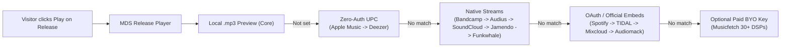

# MDS Audio Providers — User & Administrator Manual

- **Plugin:** MDS Audio Providers
- **Version:** `2.1.0`
- **Requires:** WordPress `7.0+` (tested up to `7.x`), PHP `8.0+`, **MDS Release Manager** (Unified Audio API)
- **License:** GPL-2.0-or-later

## Table of Contents

1. [Overview & How It Works](#1-overview--how-it-works)
2. [Installation & Multisite Setup](#2-installation--multisite-setup)
3. [Configuring Audio Providers](#3-configuring-audio-providers)
4. [Per-Release Audio Setup (Release Editor)](#4-per-release-audio-setup-release-editor)
5. [Caching & Performance](#5-caching--performance)
6. [Appendix: Blocks & Shortcodes Reference](#6-appendix-blocks--shortcodes-reference)
7. [Troubleshooting, Uninstall & FAQ](#7-troubleshooting-uninstall--faq)

---

## 1. Overview & How It Works

**MDS Audio Providers** connects **MDS Release Manager**'s mobile-first **Release Player** to twelve external streaming services—combining zero-configuration UPC/EAN previews, indie & self-hosted HTML5 audio streams, and official Terms-of-Service-compliant embed players.

When a visitor clicks Play on a Release page, MDS Release Manager checks your enabled providers from top to bottom and plays the first available source:



### Included Providers at a Glance

| Provider | How It Matches a Release | API Key Needed? | Playback Type |
| :--- | :--- | :--- | :--- |
| **Apple Music** | Release Barcode (UPC/EAN) | No (zero-auth) | Native 30s `.m4a` |
| **Deezer** | Release Barcode (UPC/EAN) | No (zero-auth) | Native 30s `.mp3` |
| **Bandcamp** | Bandcamp Album ID / URL | No (zero-auth) | Native stream + optional Embed fallback |
| **Audius** | Audius Track / Album / Playlist URL | No (zero-auth) | Native 320kbps `.mp3` |
| **SoundCloud** | SoundCloud Track / Playlist URL | Yes (free OAuth 2.1 app) | Native 30s `/preview` or stream |
| **Jamendo** | Jamendo Album / Track URL | Yes (free Client ID) | Native `.mp3` |
| **Funkwhale** | Funkwhale Pod Album / Track URL | No (public pods) / optional Bearer token | Native HTML5 stream |
| **Spotify** | Release UPC/EAN or Spotify URL | Optional (OAuth 2.0 for UPC; URL embed works zero-auth) | Native `preview_url` + optional Embed fallback |
| **TIDAL** | Release UPC/EAN or TIDAL URL | Optional (OAuth 2.0 for UPC; URL embed works zero-auth) | Official TIDAL iframe |
| **Mixcloud** | Mixcloud Show / Mix URL | No (zero-auth) | Official Mixcloud widget |
| **Audiomack** | Audiomack Song / Album / Playlist URL | No (zero-auth) | Official Audiomack iframe |
| **Musicfetch** | Release Barcode (UPC/EAN) | Optional (paid BYO `x-token`) | Native 30s preview clips |

---

## 2. Installation & Multisite Setup

### Single-Site Installation

1. Ensure **MDS Release Manager** is installed and active.
2. In WordPress Admin, go to **Plugins → Add New → Upload Plugin** and upload `mds-audio-providers-2.1.0.zip`.
3. Click **Activate Plugin**.
4. Navigate to **Releases → Settings → Audio Providers**.

### WordPress Multisite (Hub & Spoke)

1. Upload and **Network Activate** both **MDS Release Manager** and **MDS Audio Providers** from **Network Admin → Plugins**.
2. On the **Hub site**, configure provider URLs/IDs (Bandcamp, SoundCloud, Audius, Mixcloud, etc.) inside each Release's **Audio Providers** metabox.
3. On each site where you display releases, configure provider priority and optional credentials under **Releases → Settings → Audio Providers** (or share OAuth/API keys network-wide via `wp-config.php` constants).

---

## 3. Configuring Audio Providers

Open **Releases → Settings → Audio Providers** (if MDS Release Manager is temporarily inactive, a fallback screen is available under **Settings → Audio Providers**).

> **Screenshot:** *Releases → Settings → Audio Providers showing the ordered provider cards, inline enable toggles, status badges, and expanded credential drawer.*

### Reordering & Toggling Providers

1. Use the **Up / Down arrows** on any provider card to change resolution priority (top-most enabled provider is tried first).
2. Use the inline **Enable toggle** to disable providers your label does not use. Disabling a URL-based provider also hides its input box on the Release editor to keep your workspace uncluttered.
3. Click **Save Audio Provider Settings** at the bottom of the panel.

### Per-Provider Iframe Embed Fallback Toggles

Open the drawer for **Spotify** or **Bandcamp** to control **Allow iframe embed fallback**:
- **Spotify:** When enabled (default), renders the official Spotify embed player if Spotify returns no native `preview_url` (common for standard developer apps) or if a release has a `spotify_url` without API keys. Turn it off if you want strictly native HTML5 audio.
- **Bandcamp:** When enabled (default), falls back to Bandcamp's official `EmbeddedPlayer` iframe if direct track streams cannot be resolved.

### Adding API Credentials & Testing Connections

Open the drawer for **SoundCloud**, **Spotify**, **TIDAL**, **Jamendo**, **Funkwhale**, or **Musicfetch**:
1. Enter your Client ID / Client Secret (or Pod URL / API Key). Existing secrets are encrypted at rest with AES-256-GCM and masked on screen—leave a field blank to keep the saved value.
2. Click **Save Audio Provider Settings**.
3. Click **Test Connection** inside the drawer to verify live connectivity.

#### Optional `wp-config.php` Constant Overrides

For staging/production parity or Multisite networks, define constants in `wp-config.php` (these automatically take precedence over database settings):

```php
define( 'MDS_AP_SOUNDCLOUD_CLIENT_ID', '...' );
define( 'MDS_AP_SOUNDCLOUD_CLIENT_SECRET', '...' );
define( 'MDS_AP_SPOTIFY_CLIENT_ID', '...' );
define( 'MDS_AP_SPOTIFY_CLIENT_SECRET', '...' );
define( 'MDS_AP_TIDAL_CLIENT_ID', '...' );
define( 'MDS_AP_TIDAL_CLIENT_SECRET', '...' );
define( 'MDS_AP_JAMENDO_CLIENT_ID', '...' );
define( 'MDS_AP_FUNKWHALE_POD_URL', 'https://open.audio' );
define( 'MDS_AP_FUNKWHALE_TOKEN', '...' );
define( 'MDS_AP_MUSICFETCH_API_KEY', '...' );
```

---

## 4. Per-Release Audio Setup (Release Editor)

When editing a **Release** on the Hub site, scroll to the **Audio Providers** metabox.

> **Screenshot:** *Release Edit screen showing the conditional Audio Providers metabox with Bandcamp Verify URL and enabled URL-based provider fields.*

- **Automatic UPC/EAN Providers:** Enter the release's **Barcode (UPC/EAN)** in the main Release Details panel. **Apple Music**, **Deezer**, **Spotify**, **TIDAL**, and **Musicfetch** resolve automatically—no extra per-release fields required.
- **Automatic Release Links Detection:** If you already entered a SoundCloud, Audius, Jamendo, Funkwhale, TIDAL, Mixcloud, Audiomack, or Spotify link in Core's Release Links panel, MDS Audio Providers detects it automatically.
- **Bandcamp Verification & Host-Block Workaround:**
  1. Paste your Bandcamp album URL and click **Verify URL** to populate the numeric **Bandcamp Album ID**.
  2. If your web host's datacenter IP is rate-limited by Bandcamp, paste Bandcamp's **Share / Embed `<iframe>` code** directly into the URL field (your browser extracts the Album ID and URL locally) or enter the numeric Album ID manually.
  3. Once verified, click **Use Bandcamp URL** in the **Buy Now** panel to add a **Digital Download / Bandcamp** purchase link in one click.

---

## 5. Caching & Performance

MDS Audio Providers caches resolved manifests selectively in WordPress transients so visitor page loads stay fast:
- **12 hours:** Apple Music, Deezer, Spotify, TIDAL, Jamendo, Mixcloud, Audiomack, Musicfetch.
- **1 hour:** Audius, Funkwhale.
- **30 minutes:** Bandcamp (short TTL so signed stream tokens stay fresh).
- **15 minutes:** SoundCloud (short TTL for signed stream URLs).
- **3 minutes:** Negative error backoff (prevents repeated timeouts if an upstream API is temporarily unreachable; Musicfetch also honors HTTP `429 Retry-After`).

To clear cached lookups manually, open **Releases → Settings → Audio Providers → Cache & Diagnostics** and click **Clear Audio Provider Cache**. You can also opt in to automatic purging via **MDS Release Manager → Settings → Cache Manager** (`MDS Audio Providers Cache` companion adapter).

---

## 6. Appendix: Blocks & Shortcodes Reference

MDS Audio Providers **does not register separate blocks or shortcodes**. All twelve providers power **MDS Release Manager**'s unified **Release Player**:

| Type | Name / Tag | Usage Example |
| :--- | :--- | :--- |
| **Gutenberg Block** | **Release Player** (`mds-rm/release-player`) | Insert the **Release Player** block in the Block Editor on any Release page or landing page. |
| **Shortcode** | `[release-player]` | `[release-player]` (auto-detects current Release) or `[release-player id="123"]`. |
| **Automatic Slot** | **Release Links** audio slot | Automatically displays the unified player inside MDS Release Manager's Release Links block when audio is available. |

---

## 7. Troubleshooting, Uninstall & FAQ

- **No audio player appears on a Release:** Confirm the release has a valid **Barcode (UPC/EAN)** or an enabled provider URL/ID, then open **Releases → Settings → Audio Providers → Cache & Diagnostics** and click **Clear Audio Provider Cache**.
- **Spotify shows "Embed Only" or plays nothing:** Standard Spotify developer apps return `preview_url: null`. Ensure **Allow iframe embed fallback** is toggled **On** inside Spotify's drawer, and either configure Spotify OAuth credentials (for UPC lookup) or add the release's Spotify URL.
- **Bandcamp "Verify URL" says HTTP 403 / 429 / bot challenge:** Paste Bandcamp's Share/Embed `<iframe>` code into the **Bandcamp Release URL** field or type the numeric **Bandcamp Album ID** manually.
- **Debugging:** Enable `WP_DEBUG` and `WP_DEBUG_LOG` in `wp-config.php` to log `[MDS Audio Providers]` upstream errors to `wp-content/debug.log`.
- **Uninstalling:** Deleting **MDS Audio Providers** removes its options (`mds_ap_credentials`, `mds_ap_provider_options`, `mds_ap_cached_keys`) and cached `mds_ap_*` transients across single-site and Multisite installs while **preserving** your Release post metadata so your catalog data is never lost.
